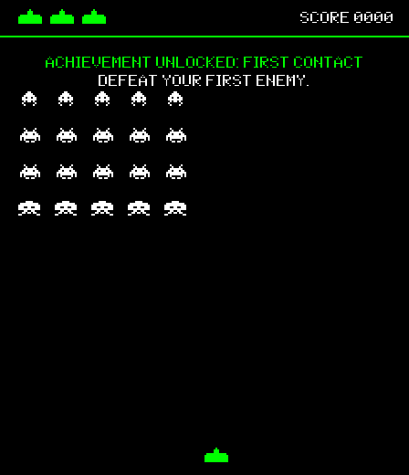
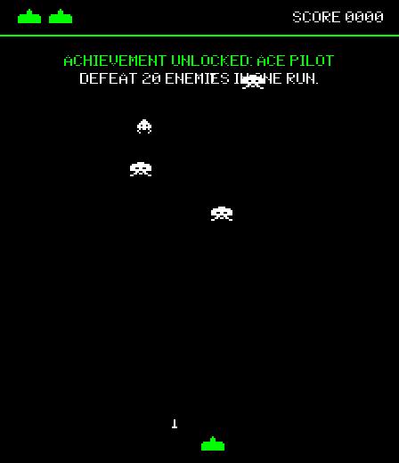
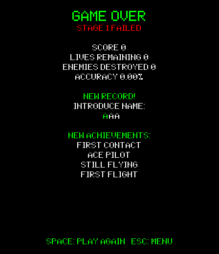
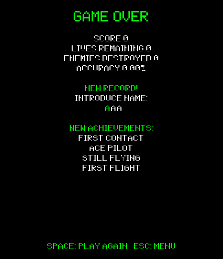

# PR #10: Achievement notifications and run summaries

Reviewed for woshi777 with Codex assistance on 2026-10-16 (Asia/Shanghai).

- Target: https://github.com/clover0409/Invaders-SDP-24592/pull/10
- Tested commit: `7560acd276bbbff602c8de42aefc0240e62444a9`
- Feature delta inspected: `9493a96...7560acd276bbbff602c8de42aefc0240e62444a9`
- Result: the executed feature checks passed; manual playthrough and audible audio remain outstanding.

## Executed checks

| Check | Observed result |
| --- | --- |
| Production compilation | PASS: 59 Java source files |
| Existing RecordsSmokeTest | PASS: 92 checks |
| Existing GameplayIntegrationTest | PASS: 18 checks |
| Existing GameScreenWavesTest | PASS: existing wave-list checks completed |
| Live Campaign/Infinite UI checks | PASS: 28 assertions; 12 additional WAV decode checks |
| FIFO notification timing | PASS: Infinite 3008 ms; Campaign 3012 ms |
| Input during notifications | PASS: ship movement and shooting continued |
| Result summary | PASS: three seeded gameplay unlocks plus First Flight retained |
| Result controls | PASS: high-score cursor/character editing, Space replay in the same mode, Esc to menu |

## Method and limits

The checks were run on Linux with OpenJDK 21.0.12.1. Production source, tests, dependency declarations and lockfiles of the reviewed PRs were left unchanged. GUI checks ran the actual `engine.Core` in a real AWT window on an isolated X11 display and sent OS keyboard events with `java.awt.Robot`.

The GUI review uses synthetic profiles, achievement events and a forced zero-lives condition to reach result screens deterministically. These screenshots do not demonstrate a natural 20-kill/60-second run or a complete Campaign playthrough. The existing gameplay integration suite independently exercises actual collision handlers. A five-achievement victory image is a rendering stress fixture, not a claim that all five can unlock naturally in one run.

All 12 bundled WAV files decoded successfully. The machine has no supported audio output line; BGM/SFX playback logged `No line matching interface Clip`. Audible playback, a full manual playthrough and threshold/difficulty calibration remain unverified.

The original `RecordsSmokeTest.testShutdownHookFlush` hard-codes `bin/java.exe`. A native Linux invocation initially fails at that subprocess launch. A local Java-home compatibility directory supplies a `java.exe` alias for the real Java launcher; the unchanged shutdown test then launches its child process and verifies all 80 pending records survive restart. This is a test portability limitation, not a confirmed defect in the reviewed UI behavior. The supplied runner preserves assertions and subprocess exit status.

No blocking application defect was confirmed in the reviewed feature delta. No application code fix or merge was made. Follow the team's prerequisite and merge order; this review does not replace final team acceptance.

## Screenshot evidence

These are actual-window screenshots from the synthetic-event GUI run.

The PR #11 report additionally includes the inherited Campaign victory/full-achievement offscreen stress rendering. PR #10's own suite and GUI run were executed separately at its exact SHA.

Logs: [suite results](results.json), [live notifications](logs/notifications-live.log).
